# 🔔 energy-bracelet-diy｜加壹点能量 · 能量契约手串DIY小程序（FLAG镌刻定制 · 微信小程序源码 · 可定制开发）

> **🏆 Recommended Repository Name（推荐仓库名）**
>
> **`energy-bracelet-diy`**
>
> 备选：`energy-covenant-bracelet` / `crystal-energy-diy-shop` / `zhusha-bracelet-miniprogram`
>
> 中文完整名：**加壹点能量能量契约手串DIY定制商城小程序**

> [!IMPORTANT]
> **演示版：微信小程序搜索「柒柒水晶手串DIY」　微信联系：`lipotes`　官方网站：[https://rwacn.net/](https://rwacn.net/)**
>
> 我们深耕 DIY 板块，是目前**全国专注于此赛道的技术服务商**，支持可以面谈，并且**对公支付，可开票**。
>
> **服务流程**：① 建立服务群 → ② 案例展示 → ③ 需求确定 → ④ 签订服务合同 → ⑤ 对公打款 → ⑥ 开始搭建（协助备案以及各项资质办理）→ ⑦ 售后服务群

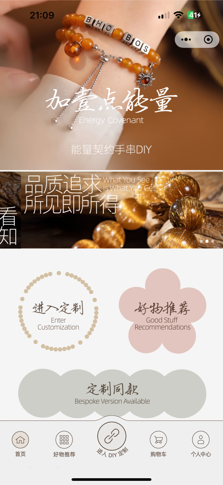

**一款「能量契约 FLAG 镌刻 + 手串在线 DIY + 成品商城 + 会员合伙人分销」的能量饰品定制微信小程序**

`DIY 设计器` · `FLAG 镌刻定制` · `珠径手围对照` · `成品商城` · `会员等级` · `合伙人分销`

---

## 📖 项目简介

**加壹点能量**（Energy Covenant · 能量契约手串 DIY）是一款主打「锚定能量、镌刻契约」的能量饰品定制微信小程序。DIY 设计器集**色彩、天然材质、精油芳香、五行本命、东方能量**于一体，支持 **FLAG 箴言、名字、纪念日、宠物铭牌**等个性化镌刻定制；搭配 13~24cm 全档手围选择与**珠径 × 手围对照表**自动算珠，白水晶、粉水晶、幽灵、碧玺等分级珠材按克拉明码标价。商城直售朱砂等成品手串，会员体系内置**等级折扣 + 合伙人邀请分销 + 积分抵扣**（1 积分抵 1 元），是「个性镌刻 + DIY 定制 + 电商 + 私域分销」四合一的能量饰品垂类解决方案。

## ✨ 核心功能

| 模块 | 功能说明 |
| --- | --- |
| 🔗 **能量契约 DIY** | 「锚定能量 · 镌刻契约」：集色彩、天然材质、精油芳香、五行本命、东方能量为一体，支持 FLAG 箴言、名字、纪念日、宠物铭牌等镌刻定制 |
| 📐 **手围智能测算** | 13~24cm 共 12 档手围直接选择；软尺绕腕一圈即测；内置**珠径 × 手围对照表**（6~22mm 珠径 × 130~200mm 手围），自动给出对应珠颗数，适用尺寸 = 手围数 + 2~6 厘米 |
| 🎨 **DIY 设计器** | 手围 240mm / 适用 242mm / 估价 ¥591 实时联动；绳型可选喜用款 / 喜好款 / 弹力绳；珠材按白水晶 / 粉水晶 / 黄水晶 / 紫水晶 / 茶水晶 / 幽灵发晶胶花 / 蓝宝碧玺兔毛等分类，7A 透体千层幽灵 8mm ¥11 至 14mm ¥42 明码标价，清空 / 保存 / 完成设计一键操作 |
| 🛍️ **好物推荐商城** | 沉浸式场景化推荐（全息疗愈 · 随时邀请），成品手串卡片化展示：辟邪安神 ¥241、一束耀眼金色光芒 ¥987、幻彩幽紫 ¥302、深海蓝韵 ¥612 等，所见即所得 |
| 📦 **商品详情与订单** | 详情页含划线价、库存、销量（1431 件）、规格已选、物流配送与评价区；订单页支持收货地址、买家留言、**积分抵扣开关**（满 ¥300 可用）与价格明细 |
| 👑 **会员等级体系** | 升级累计积分 / 可用积分 / 购物折扣三维展示，等级制专属折扣（如曜石 · 9.9 折），所有等级下单包邮，积分抵扣不影响升级累计值 |
| 🤝 **合伙人分销** | 邀请 0/12 位好友完成消费即进阶合伙人；我的收益分待结算 / 可提现，一键申请提现；专属邀请码自动生成复制分享，好友完成消费得 10 积分、定制同款 FLAG 得 5 积分 |
| 💰 **积分体系** | 1 积分抵 1 元（不抵运费），完成订单得 10 积分，支持口令兑换积分与获赠礼品 |

## 🖼️ 功能预览

### 首页 · 能量契约手串 DIY

首屏实拍主视觉「加壹点能量 Energy Covenant」，主张**品质追求 · 所见即所得**；三大入口花瓣式排布：**进入定制**（Enter Customization）、**好物推荐**（Good Stuff Recommendations）、**定制同款**（Bespoke Version Available）；底部导航覆盖首页 / 好物推荐 / 进入 DIY 定制 / 购物车 / 个人中心。

### 好物推荐 · 全息疗愈场景

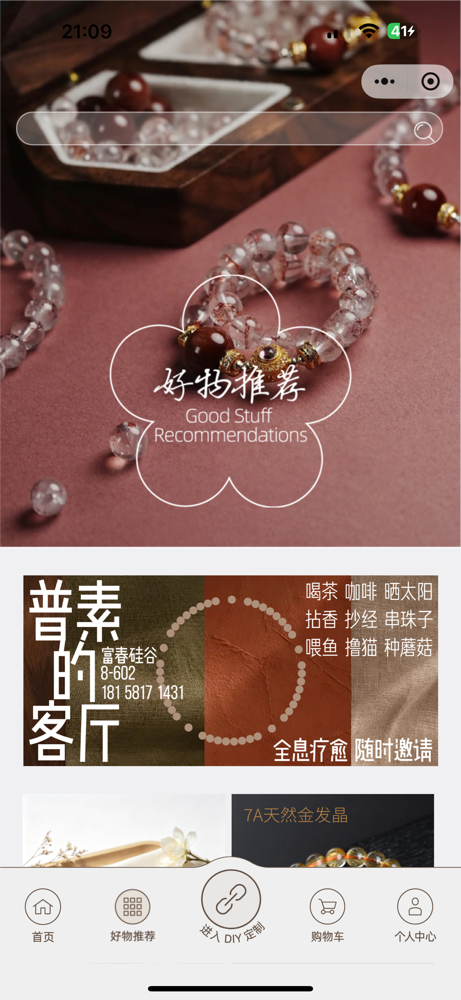

场景化推荐页「全息疗愈 · 随时邀请」：喝茶咖啡晒太阳、拈香抄经串珠子、喂鱼撸猫种蘑菇的生活方式提案，联动「普素的客厅」疗愈空间展示，7A 天然金发晶等好物沉浸式呈现。

### 好物推荐 · 成品列表

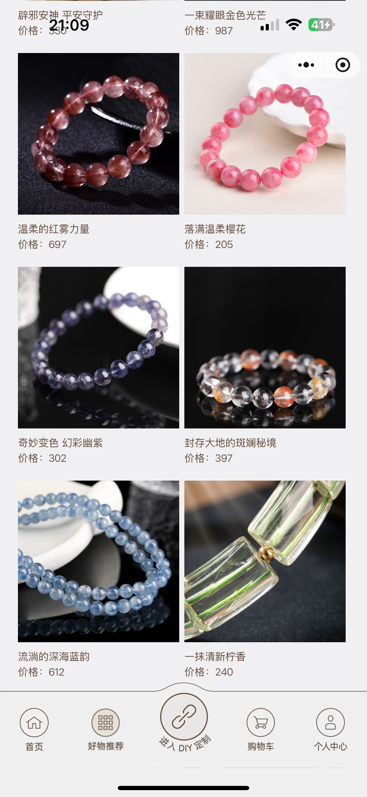

成品手串双列卡片流：辟邪安神·平安守护 ¥241、一束耀眼金色光芒 ¥987、温柔的红元素 ¥697、落满温柔樱花 ¥205、奇妙变色·幻彩幽紫 ¥302、封存大地的斑驳秘境 ¥397、流淌的深海蓝韵 ¥612、一抹清新竹香 ¥240，实拍图 + 意境命名 + 明码标价。

### 能量契约 DIY · 镌刻定制

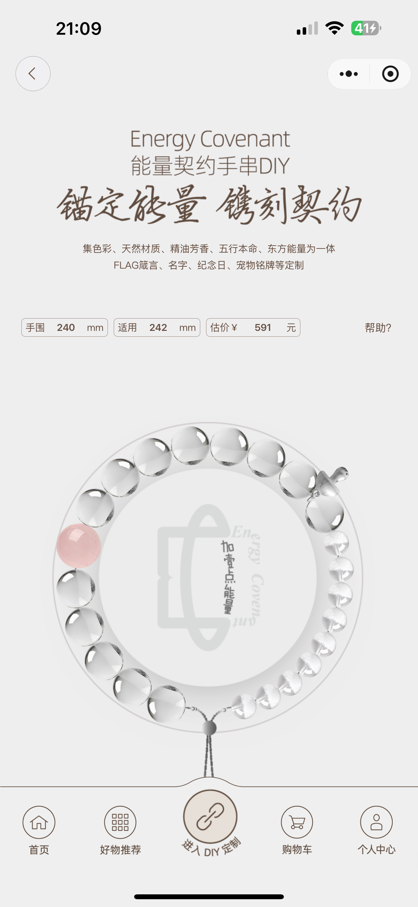

DIY 定制首页「锚定能量 · 镌刻契约」，支持 **FLAG 箴言、名字、纪念日、宠物铭牌**等定制；顶部实时联动**手围 240mm / 适用 242mm / 估价 ¥591**，悬浮预览区实时渲染手串效果，右上有帮助入口。

### 手围尺寸 · 珠径对照表

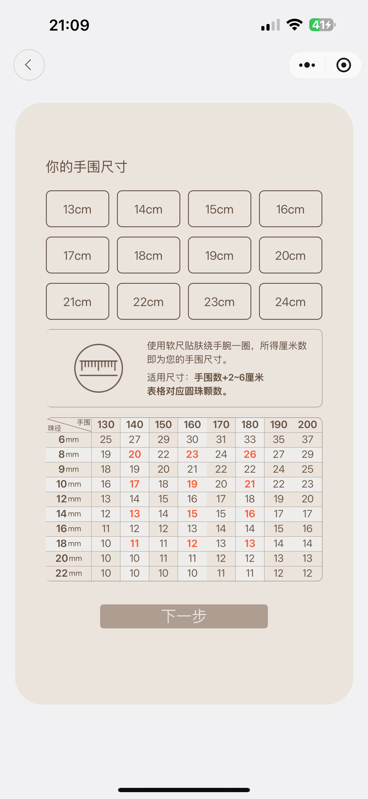

13~24cm 共 12 档手围按钮直选；软尺绕腕一圈所得厘米数即手围，**适用尺寸 = 手围数 + 2~6 厘米**；内置**珠径 × 手围对照表**：6~22mm 十档珠径对应 130~200mm 手围的珠颗数（如 8mm 珠 + 160mm 手围 = 23 颗），关键交叉格高亮提示，选珠不迷路。

### DIY 设计器 · 分级珠材明码标价

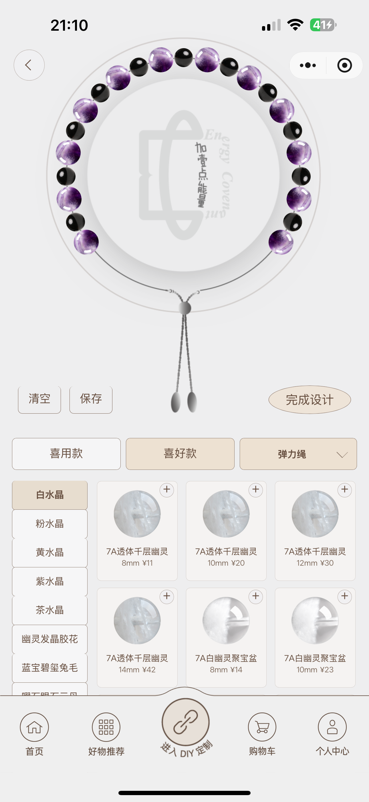

设计器实时渲染手串，清空 / 保存 / 完成设计三键操作；**绳型可选喜用款 / 喜好款 / 弹力绳**；珠材侧栏按白水晶 / 粉水晶 / 黄水晶 / 紫水晶 / 茶水晶 / 幽灵发晶胶花 / 蓝宝碧玺兔毛等分类，7A 透体千层幽灵 8mm ¥11、10mm ¥20、12mm ¥30、14mm ¥42，7A 白幽灵聚宝盆 8mm ¥14、10mm ¥23，逐颗点选加珠。

### 商品详情 · 朱砂成品直购

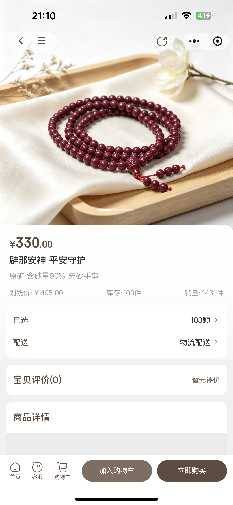

成品详情页：辟邪安神·平安守护 **¥330.00**（原矿含砂量 90% 朱砂手串），划线价 ¥499.00、库存 100 件、销量 1431 件；已选规格 108 颗、物流配送、宝贝评价分区展示；底部首页 / 客服 / 购物车 + **加入购物车 / 立即购买**双按钮。

### 待付款订单 · 积分抵扣

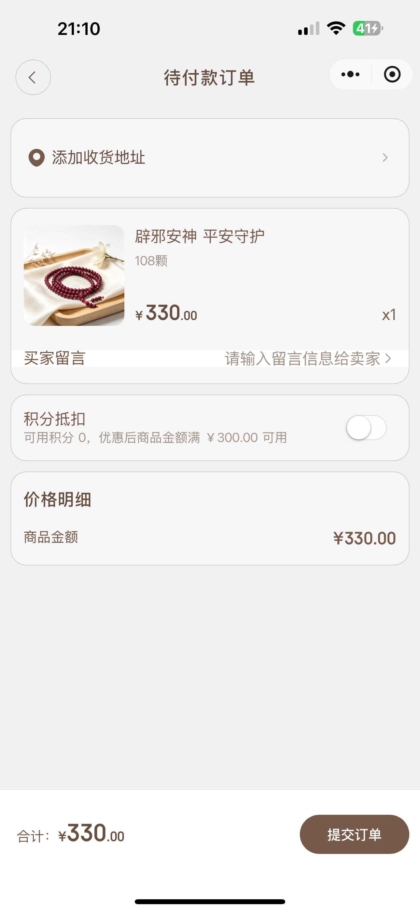

订单页含添加收货地址、商品信息（108 颗 ×1）、买家留言；**积分抵扣开关**（可用积分 0，优惠后商品金额满 ¥300 可用）；价格明细商品金额 ¥330.00，合计与提交订单按钮清晰。

### 个人中心 · 六宫格服务

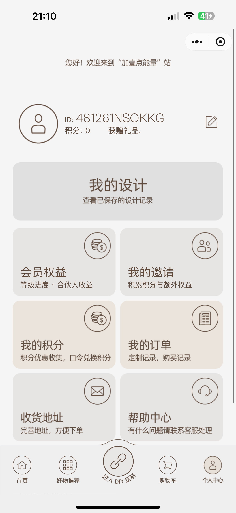

个人 ID 与积分 / 获赠礼品展示；「我的设计」查看已保存的设计记录；六宫格服务：**会员权益**（等级进度 · 合伙人收益）、**我的邀请**（积累积分与额外权益）、**我的积分**（口令兑换积分）、**我的订单**（定制记录 · 购买记录）、**收货地址**、**帮助中心**。

### 会员权益与收益 · 合伙人进度

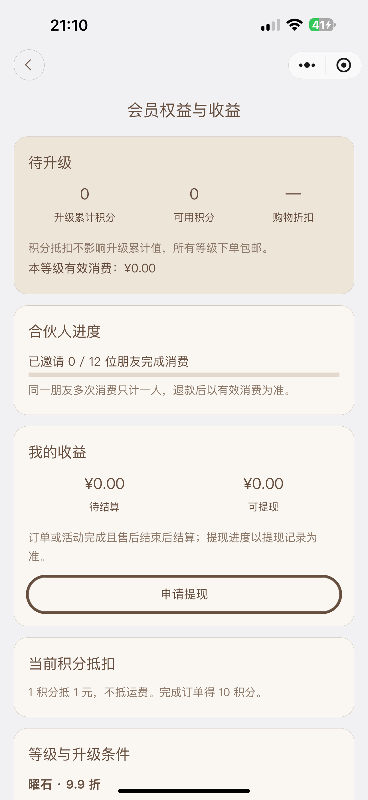

会员面板三段式：**待升级**（升级累计积分 / 可用积分 / 购物折扣，积分抵扣不影响升级累计值，所有等级下单包邮）；**合伙人进度**（已邀请 0/12 位朋友完成消费，同一好友多次消费只计一人，退款后以有效消费为准）；**我的收益**（待结算 / 可提现，售后结束结算，一键申请提现）；积分规则 1 积分抵 1 元不抵运费、完成订单得 10 积分；等级与升级条件对应专属折扣（曜石 · 9.9 折）。

### 我的邀请 · 邀请码裂变

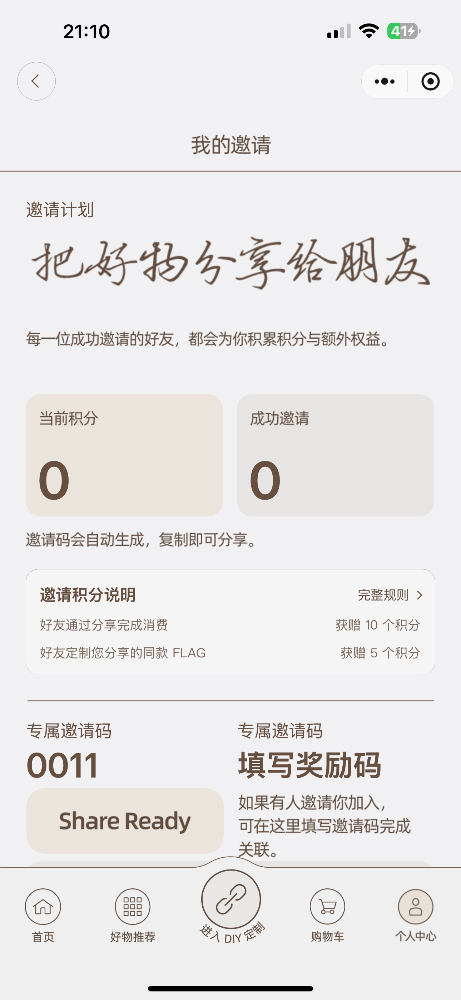

「把好物分享给朋友」：当前积分与成功邀请双数据卡；**专属邀请码自动生成复制分享**（如 0011，Share Ready）；邀请积分说明完整公示——好友通过分享完成消费获赠 10 个积分、好友定制您分享的同款 FLAG 获赠 5 个积分；支持**填写奖励码**完成关联。

### 帮助中心

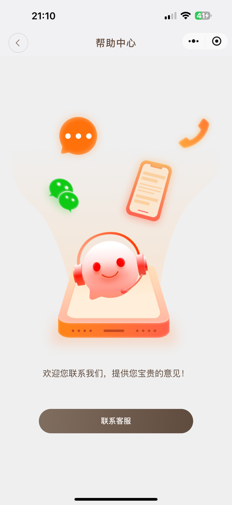

「欢迎您联系我们，提供您宝贵的意见！」一键**联系客服**，售后与咨询链路闭环。

## 🧭 业务流程

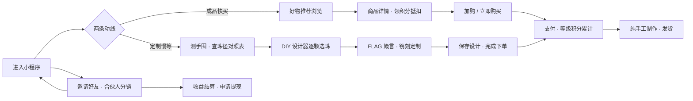

## 🎯 适用场景

- 💎 **能量饰品 / 水晶品牌方**：FLAG 镌刻 + DIY 定制 + 成品商城，情感溢价与客单价双升
- 🔮 **身心灵 / 疗愈空间**：线上线下联动（如疗愈客厅场景植入），私域内容化运营
- 🤝 **需要分销体系的商家**：会员等级 + 合伙人邀请 + 积分抵扣的完整增长引擎
- 💼 **技术合作伙伴**：全国专注 DIY 赛道的技术服务商，支持面谈、对公支付、可开票

## 📮 联系我们

| 项目 | 信息 |
| --- | --- |
| 📱 演示小程序 | 微信搜索「**柒柒水晶手串DIY**」 |
| 💬 微信 | `lipotes` |
| 🌐 官方网站 | [https://rwacn.net/](https://rwacn.net/) |
| 🧾 合作方式 | 支持面谈 · 对公支付 · 可开票 |

### 🧾 完整服务流程

1. 建立服务群
2. 案例展示
3. 需求确定
4. 签订服务合同
5. 对公打款
6. 开始搭建（协助备案以及各项资质办理）
7. 售后服务群

---

**加壹点能量 · 锚定能量，镌刻契约** ✨

---

## 🔎 关键词 Keywords / SEO Tags

**EN:** `energy bracelet DIY` · `crystal bracelet maker` · `bracelet customizer` · `engraved bracelet app` · `custom name bracelet` · `memorial pet tag bracelet` · `intention bracelet` · `affirmation jewelry` · `energy covenant bracelet` · `gemstone bracelet shop` · `cinnabar bracelet` · `healing crystal store` · `bead size calculator` · `wrist size calculator` · `bracelet length chart` · `elastic cord bracelet` · `wechat mini program` · `wechat miniprogram ecommerce` · `miniprogram source code` · `product customizer` · `jewelry e-commerce template` · `membership tier system` · `partner referral program` · `points & rewards system` · `points deduction checkout` · `affiliate commission withdrawal` · `invite code system` · `social commerce` · `flash sale pricing` · `crystal shop miniprogram`

**中文：** `手串DIY` · `能量手串` · `水晶手串DIY` · `手串定制` · `能量契约` · `加壹点能量` · `镌刻定制` · `刻字手串` · `名字手串` · `纪念日礼物` · `宠物铭牌` · `FLAG箴言` · `五行本命` · `东方能量` · `精油芳香` · `天然材质` · `白水晶` · `粉水晶` · `黄水晶` · `紫水晶` · `茶水晶` · `幽灵水晶` · `发晶` · `蓝宝碧玺` · `兔毛水晶` · `7A水晶` · `透体千层幽灵` · `聚宝盆` · `朱砂手串` · `原矿朱砂` · `辟邪安神` · `手围测量` · `手围对照表` · `珠径对照表` · `弹力绳` · `喜用款` · `DIY设计器` · `在线定制` · `好物推荐` · `成品商城` · `微信小程序` · `小程序源码` · `小程序开发` · `小程序定制` · `商城小程序` · `会员等级` · `等级折扣` · `合伙人分销` · `邀请码` · `积分抵扣` · `积分兑换` · `口令兑换` · `收益提现` · `购物车` · `订单管理` · `销量展示` · `划线价` · `满额包邮` · `源码交付` · `可开票` · `对公支付`

**长尾搜索词 Long-tail：** 手串DIY小程序源码 / 能量手串定制小程序开发 / 刻字手串小程序怎么做 / 宠物铭牌手串定制 / 纪念日礼物定制小程序 / 朱砂手串商城小程序 / 珠径手围对照表怎么算 / 8mm手串160手围多少颗 / 会员等级折扣小程序系统 / 合伙人分销小程序源码 / 邀请码裂变小程序开发 / 积分抵扣购物车小程序 / 收益提现分销系统开发 / 好物推荐场景化商城小程序 / 能量饰品创业项目 / 定制类小程序服务商推荐

---

**Made with 🔗 by 加壹点能量** · [rwacn.net](https://rwacn.net/) · WeChat `lipotes`
